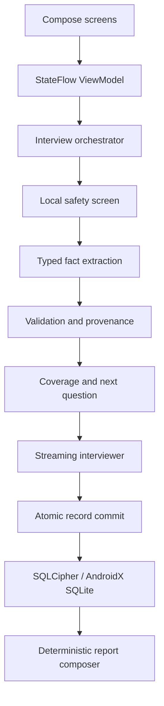

# Architecture

The app is native Android. `domain` is a pure Kotlin/JVM module; `verification` runs provider tests on the JVM without an Android UI build; `app` contains explicit feature packages for UI, AI, networking, encrypted storage, security and reports. A small application composition root supplies dependencies. Hilt was deliberately omitted: no runtime service graph, workers or backend currently justify it. WorkManager is not used because health-data inference should not resume silently in the background.

## Logical responsibilities

| Responsibility | Implementation | Model calls |
|---|---|---|
| Orchestrator | `ai/InterviewOrchestrator.kt`, mutex, immutable snapshot and revision checks | None directly beyond delegation |
| Interviewer | `Prompts.INTERVIEWER`, Responses SSE parser | One streaming call after extraction |
| Extractor | Strict JSON schema, source quote matching, local type/unit/date validation | One structured call |
| Coverage auditor | `Coverage`, `Specification`, dynamic per-cycle fields | None |
| Safety guard | Local phrases plus structured urgent flag; persistent in-chat escalation text | Shares extraction call |
| Report composer | Local field-to-report mapping; no narrative inference | None |

Calls are bounded; there is no autonomous loop or provider-hosted conversation. Synthetic setup tests are two small calls, one schema call and one stream. Models returned by `/models` are not assumed compatible until tested.

## Transaction invariants

1. A patient response is committed locally as PENDING before any external request.
2. At most one interview operation runs in this app instance. UI profile switching is disabled while it runs.
3. Consent, patient session and record revision are checked before **every network attempt**, and again before committing results.
4. Failed/cancelled turns preserve the same user-message ID; retries reuse it. HTTP retries may incur duplicate provider computation, but local facts/messages cannot be duplicated by the retry path.
5. Extraction and the next question are provisional until the stream emits `response.completed`. EOF without completion is failure.
6. Final facts and assistant response are saved together in one encrypted SQLite transaction. Any competing local mutation invalidates the inference snapshot.
7. Every fact references a real user message and exact quote. Repeated extraction for the same field/message is ignored.
8. A changed existing fact becomes CONFLICTING; the original revision remains. A local explicit correction creates a reviewed replacement with a `supersedes` link.
9. Switching treatment pathway preserves shared facts and all previously recorded cycles. Fresh sessions reuse dated facts; the JSON retains timestamps; clinicians must review whether old information is still current.
10. Deleting a conversation removes its facts and dependent revisions, plus saved report snapshots. This avoids dangling provenance and reports retaining supposedly deleted data.

## Three memory layers

The encrypted record contains complete local messages, append-only structured facts and report snapshots. Summary memory is a deterministic projection of current structured facts, regenerated on demand rather than another writable source of truth. AI context includes language, pathway, stage, next field, a capped structured summary and eight recent messages. The patient nickname and database identity are omitted from the prompt context. Field specification is supplied to the extraction call.

The summary cap is 24,000 characters, each recent message is capped at 2,500 characters and incoming messages at 12,000 characters. These are character budgets, not exact tokenizer accounting. The deterministic next-question selection sees the full local record even if old context is omitted. A long-record salience selector is still a release improvement.

## Storage and migrations

Database schema version 1 stores one encrypted JSON aggregate per patient, with an SQL revision column used for compare-and-set updates. The aggregate has its own schema version. The SQL schema snapshot is committed. Unknown aggregate versions fail closed. Schema upgrade/downgrade callbacks fail closed; no destructive migration fallback is configured. No v0-to-v1 migration is claimed because this is the first schema; future upgrades require SQL migrations plus explicit aggregate migrations and fixtures.

The database has local profile isolation, not a multi-user clinic authorization model. Everyone who can unlock this installation can access its profiles. A production shared clinic device needs a separate clinician identity/authorization design.

## Presentation and reports

Navigation Compose hosts dashboard, interview, record/history/report and settings. Language selection and welcome are initial routes. Consent precedes patient inference. Android resources provide eight locales. System script fallback fonts render different scripts; bundled brand fonts and translator approval remain future polish.

Reports are deterministic local snapshots. They show actual status and reviewed/unreviewed labels, missing fields and conflicting old/new values. Existing test results are optional history fields, never a request for new tests. Values are preserved in their original language while labels follow the selected report locale; there is no fabricated translation of medical facts and no claim of FHIR conformance.

PDF uses Android StaticLayout for text shaping and line-aware pagination. Export writes straight to the selected document provider. Explicit sharing uses that URI and a temporary read grant; there is no broad exported file provider or plaintext app cache.

Direct AndroidX SQLite access is used with SQLCipher instead of Room-generated adapters. The data model consists of one strongly typed versioned aggregate per profile; a small parameterized SQL layer makes transactions and optimistic revisions explicit and removes the annotation-processor dependency. UI/network callers never execute SQL directly.
